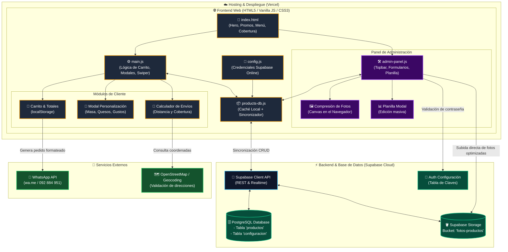

# Arquitectura del Sistema - Pizzería Belgrano

> Este documento se actualiza automáticamente cada vez que se realice una modificación en la arquitectura, base de datos, flujos de datos o componentes clave del sistema.

---

## 1. Diagrama General de Arquitectura

---

## 2. Mapa de Capas del Proyecto

### A. Capa de Presentación (Frontend)
* **Archivo base:** `PizzeriaBelgrano/index.html`
* **Estilos:** `PizzeriaBelgrano/css/main.css` (estética oscura con detalles dorados artesanales) y `admin.css`.
* **Interactividad y Menú:** `PizzeriaBelgrano/js/main.js`
  * Control del carrito lateral (`cart-drawer`).
  * Modal de personalización de pizzas (tipo de masa, quesos, ingredientes adicionales).
  * Carruseles táctiles por categoría (Pizzas, Promos, Sándwiches, Fainá, Lehmeyun, Bebidas) mediante Swiper.js.
  * Validador de cobertura y cálculo de costo de envío según distancia.

### B. Capa de Administración & Edición
* **Archivo:** `PizzeriaBelgrano/js/admin-panel.js`
* **Acceso:** Login discreto desde el header con validación híbrida (local instantánea + consulta a tabla `configuracion` en Supabase).
* **Gestión:** 
  * Edición en tarjeta directa o a través de la **Planilla** de carga masiva.
  * Compresor de imágenes en el cliente mediante HTML5 Canvas (reduce fotos pesadas antes de enviarlas).

### C. Capa de Datos y Persistencia
* **Caché y fallback local:** `PizzeriaBelgrano/js/products-db.js`
  * Carga instantánea del catálogo base en memoria y `localStorage` para velocidad de 0ms sin esperas de red.
* **Base de datos remota:** **Supabase PostgreSQL**
  * Tabla `productos`: id, nombre, descripción, precio, categoría, imagen_url, variantes, activo.
  * Tabla `configuracion`: claves de administración y parámetros globales.
* **Almacenamiento de multimedia:** **Supabase Storage**
  * Bucket público: `fotos-productos` con CDN global de alta velocidad.

### D. Hosting y Conexiones Externas
* **Hosting:** **Vercel** (`PizzeriaBelgrano/vercel.json`), despliegue automático desde GitHub.
* **Checkout:** **WhatsApp Web / App** (`wa.me/59892884951`) con mensaje estructurado (artículos, gustos seleccionados, total y dirección).
